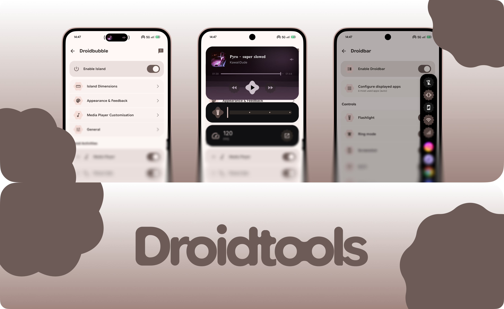

<p align="center">
  
</p>

# Droidtools

Droidtools is a lightweight suite of system overlay utilities for Android, built natively in Kotlin with Jetpack Compose and Material 3.

It packages two everyday utilities into one app:
- **Droidbubble**: An adaptive dynamic island around your front camera cutout for media, notifications, and system events.
- **Droidbar**: A slide-out edge bar on the right side of the screen for quick toggles and frequent apps.

Free, open source, no ads, and no background tracking.

---

<p align="center">
  <a href="https://github.com/Velocity081/droidtools/releases">
    
  </a>
  
  <a href="https://github.com/Velocity081/droidtools/releases/latest/download/Droidtools.apk">
    
  </a>
  <a href="LICENSE">
    
  </a>
</p>

---

## Utilities

### Droidbubble
- **Now Playing**: Album artwork, track title, seek bar, playback controls, and adaptive background blur.
- **System Events**: Battery charging wattage, ringer profile changes, and active status indicators.
- **Notifications**: Heads-up alerts with expandable previews and inline quick replies.
- **Idle Tuck**: Sits flush inside your front camera cutout when nothing is active.
- **Customization**: Position offsets, dimensions, spring tension, font picker, and layout layer reordering.

### Droidbar
- **Edge Access**: Tap a subtle bar on the right edge to expand or collapse.
- **Quick Controls**: 12-sided action buttons for Flashlight, Ring/Vibrate toggle, Wi-Fi, Mobile Data, and Screenshot.
- **App Launcher**: Quick switch between your most used apps or a custom pinned set.
- **Design**: Opaque dark surface with subtle spring physics and haptics.

---

## Requirements

- Android 13 or newer
- Permissions:
  - **Display over other apps** (Draw overlays)
  - **Accessibility Service** (Edge touch detection & system actions like screenshot)
  - **Notification Listener** (Media metadata and incoming alert banners)

---

## Building

```bash
git clone https://github.com/Velocity081/droidtools.git
cd droidtools
./gradlew assembleRelease
```

The APK will be output to `app/build/outputs/apk/release/Droidtools.apk`.

---

## License

This project is licensed under the [MIT License](LICENSE).
